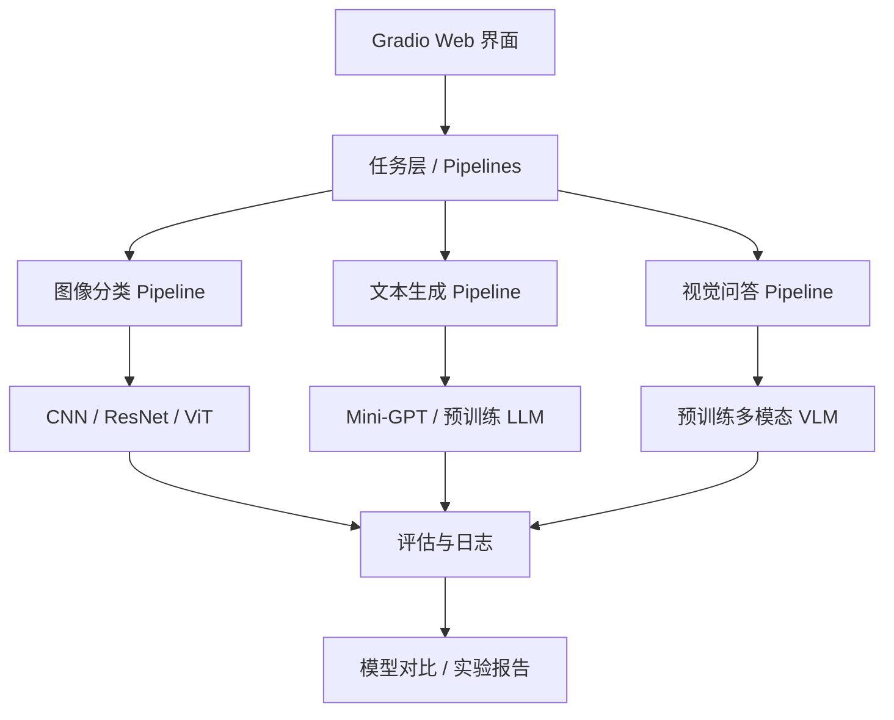

# PetVision-Lab 八周学习计划

从 Python、NumPy 和必要的数学开始，逐步实现视觉模型、Transformer 和小型语言模型，最后运行预训练 LLM / VLM。适合需要补充 Python 实践和深度学习理论、希望亲手理解计算过程的学习者。

每周投入约 30 小时，其中 24 小时用于明确任务，6 小时用于补基础、调试和复盘；八周约 240 小时。进度按检查结果推进，可以顺延。

本地使用 RTX 4060 笔记本和 Conda 环境 `petvision`，第一周以 Python 3.12、NumPy、Matplotlib 起步；第八周计划在云端 48GB GPU 上运行 LLM / VLM，型号、可用显存和依赖届时实测。

本轮完成小模型的实现、训练和实验报告，并体验预训练推理。完整 Encoder-Decoder、宠物迁移对照、模型微调和 App 放入后续拓展。首次跟做可先看[学习与执行入口](README.md)。

版本：v1.30；更新日期：2026-11-10。

## 目录

- [1. 学习目标与执行原则](#goals)
- [2. 八周总览与里程碑](#overview)
- [3. 第一阶段：基础与视觉模型（第 1-3 周）](#stage-1)
- [4. 第二阶段：Attention 与 ViT（第 4-5 周）](#stage-2)
- [5. 第三阶段：Mini-GPT 与 BPE（第 6-7 周）](#stage-3)
- [6. 第四阶段：CLIP、LLM / VLM 与总结（第 8 周）](#stage-4)
- [7. 八周之后的拓展路线与系统架构](#extensions)
- [8. 项目目录结构与逐周创建顺序](#layout)
- [9. 核心模块的职责与接口](#interfaces)
- [10. 配置、运行与工程规范](#engineering)
- [11. 实验设计与验收标准](#acceptance)
- [12. 本地与云端算力安排](#compute)
- [13. 学习资料与链接汇总](#resources)
- [14. 每周执行节奏与第一天任务](#routine)

<a id="goals"></a>

## 1. 学习目标与执行原则

### 1.1 怎样学和记录

每个主题先弄清输入、计算和输出，再写最小实现，用小张量检查后才训练。实验结束后解释结果，并在只看公式和接口的情况下重写关键代码。

- 数学随任务补：第一周推 MSE 梯度，第二周学交叉熵，第四周理解缩放与 softmax，第六周联系自回归概率。
- 核心模块亲手写：Attention、Encoder、ViT、Mini-GPT 和简化 BPE。卷积底层、自动求导和预训练大模型加载使用现成框架。
- 本轮完成 BN、残差、Patch Size 三类对照；更多种子和超参数搜索另行安排。
- 保存当次配置、划分、种子、环境、命令、指标与失败分析，结果应能追溯到具体运行。

总计划确定范围与里程碑；各周指南写文件、函数、操作和检查；各周实验 README 保存实际进度、环境、运行结果与周总结。根 README 提供项目介绍和导航。公式先在纸上或代码注释中解释，每周只整理需要保留的结论。

<a id="reading-conventions"></a>

### 阅读与代码约定

跟做时先找到当天指定的文件和函数，准备例子，完成计算，再运行检查。每一步写清修改对象、输入、操作顺序和完成标准。需要新数据或预训练权重时，先完成来源、加载和配置，再执行后续计算。

同一组件先完成实现文件，再编写测试文件；配置先于读取它的入口，被调用模块先于调用者。一个实现段写完导入、构造、参数和计算方法后再切换文件，测试数据与断言留在后面的测试段。若测试的是训练或推理入口，先接通该入口再测试。

手算步骤给出要算的数值或形状；实现步骤给出函数职责和返回值；检查步骤给出固定条件、比较项和容差。术语、接口差异和输出格式随相关操作说明。阅读一个未使用的接口、打印已有结果或重复一句结论，不单独计作实现任务。

正式实现放入指定文件；手算、草稿和随机小张量用于理解与检查。运行命令前先完成相应函数和入口。`...`、`pass` 和“自行补齐”表示待实现；依赖上文变量的片段放入指定函数。已有完整实现时，复习片段用于核对过程，修改时保留已完成的功能。

每天的自查同时检查代码输出与解释能力。测试要有明确输入、运行模式、预期输出或梯度及断言；数值对照报告实际误差。有限参考重写允许看公式和接口清单，写完后实际调用并与已有实现比较。新增测试使用指南给出的函数名，修改测试保留原名。更多路径和记录约定见[执行说明](README.md#working-rules)。

形状字母按当前任务解释：B 是批次大小，H/W 是图像或特征图高宽，T 是序列长度，C 是当前特征维度，V 是词表大小。P 在卷积中表示 padding，在 ViT 中表示 Patch 边长；N 在线性回归中是样本数，在 ViT 中是每图 Patch 数，在语言验证中是 token 总数。数学式中的 `^` 表示乘方，Python 使用 `**`；`1e-3` 表示 0.001。

<a id="implementation-reference"></a>

### 模型实现依据

模型实现优先读 D2L 对应章节，选择 PyTorch 代码；中文版缺少的章节读英文版。GPT、字节级 BPE 和预训练推理分别参考作者源码或官方模型卡。论文在实现后选读。

同一模块使用一份主要参考，核对归一化顺序、激活、bias、dropout、位置编码和参数共享。下表列出本轮采用的结构，以及教材或作者实现到本项目的改动。

| 内容 | 主要实现依据 | 保持一致的结构与必要差异 |
| --- | --- | --- |
| 第 3 周 ResNet | [D2L 7.6](https://zh.d2l.ai/chapter_convolutional-modern/resnet.html) | 7×7 stem、四阶段 [2,2,2,2]、单层 1×1 projection；项目保留 RGB CIFAR-10 / 96×96，BasicBlock 默认 use_1x1conv=True，普通块显式 False |
| 第 4 周 Attention / Encoder | [D2L 多头注意力](https://zh.d2l.ai/chapter_attention-mechanisms/multihead-attention.html)、[Transformer](https://zh.d2l.ai/chapter_attention-mechanisms/transformer.html) | Attention 默认无 bias，ReLU FFN、AddNorm 的 post-LN、正弦位置编码；项目接收已嵌入的浮点序列，Mask 用布尔张量表示 |
| 第 5 周 ViT | [D2L 英文 11.8](https://d2l.ai/chapter_attention-mechanisms-and-transformers/vision-transformer.html) | pre-LN ViTBlock、GELU、embedding / MLP dropout、CLS 分类头；项目使用 CIFAR-10 / 32×32、Patch=4/8 和较小模型 |
| 第 6 周 Mini-GPT | [nanoGPT model.py](https://github.com/karpathy/nanoGPT/blob/master/model.py) | GPT-2 风格 pre-LN、GELU、可学习位置、规定的 dropout、共享输入/输出权重；项目使用小规模字符模型与独立训练/验证/测试划分 |
| 第 7 周 BPE / 采样 | [D2L 子词嵌入](https://zh.d2l.ai/chapter_natural-language-processing-pretraining/subword-embedding.html)讲概念，[minbpe BasicTokenizer](https://github.com/karpathy/minbpe/blob/master/minbpe/basic.py)与 nanoGPT.generate 定实现 | UTF-8 字节起点、同频先遇到优先、encode 按 merge rank；top-k 按分数阈值保留并列项；项目补充严格往返和完整续训检查 |
| 第 8 周预训练推理 | 所选 [CLIP](https://huggingface.co/openai/clip-vit-base-patch32)、[SmolLM2](https://huggingface.co/HuggingFaceTB/SmolLM2-360M-Instruct)、[SmolVLM](https://huggingface.co/HuggingFaceTB/SmolVLM-256M-Instruct) 模型卡与对应版本官方文档 | 模型类、配套 processor、Chat Template 与权重 revision 成套使用；通过小样本后记录实际依赖版本 |

本项目继续保留已有数据、统一训练接口、显式模型选择和单变量实验预算；这些适配与结构依据分别说明。跨周复用 Attention、LayerNorm 等基础模块，ViTBlock 与 GPTBlock 放在各自模型文件中，按所选参考组合，不为复用而强制套用第四周 EncoderBlock。使用作者源码做数值参考时，先在对应周 README 记录实际参考版本，再对齐参数、模式、Mask 和精度。

### 1.2 时间怎样分配

每周安排六个学习日，每天 4 小时任务、1 小时机动，另留一天休息。训练等待时可以阅读或整理结果，重叠时间只计一次，GPU 耗时单独记录。

机动时间优先处理语法、数学和调试问题；仍未通过基础检查，就先补齐再进入下一周。模型对照、参考梯度检查和续训检查可以分多次做。先确认输入输出，再通过最小前反向检查，最后完成正式实验；扩展阅读和排版放在后面。结果未支持假设时，检查实现与预算后如实分析。

### 1.3 八周成果与后续成果

| 阶段 | 产出 | 具体内容 |
| --- | --- | --- |
| 八周主线 | 基础练习 | NumPy 线性回归、梯度与矩阵形状说明 |
| 八周主线 | 视觉分类实验 | MNIST MLP；CIFAR-10 CNN、ResNet18、ViT；三类对照与统一结果表 |
| 八周主线 | Transformer 核心模块 | 手写 Attention、LayerNorm、FFN、位置编码、Encoder 及关键测试 |
| 八周主线 | 语言建模实验 | Bigram、字符级 Mini-GPT、简化 BPE、采样和中断续训 |
| 八周主线 | 预训练模型体验 | CLIP 分类或检索、小型 LLM 推理、至少 20 张图片 × 每张 2 个问题的 VLM 记录 |
| 八周之后拓展 | 更完整的学习与应用 | Encoder-Decoder、宠物迁移对照、LLM / VLM 微调、Gradio 系统 |

CNN、ResNet、ViT 在相同数据集上进行分类比较；Mini-GPT 用于独立的语言建模实验；视觉问答使用真正接收图片与文本的 VLM。分类标签传给纯文本 LLM 的流程不能作为视觉理解能力的证据。

<a id="overview"></a>

## 2. 八周总览与里程碑

下表每周的明确任务预算均为 24 小时，再加 6 小时机动时间，合计 30 小时。训练等待期间可以阅读和整理结果，实验记录中另记 GPU 运行耗时，避免把同一段学习时间重复计入预算。

| 周次 | 主题 | 24 小时明确任务分配 | 本周验收成果 |
| --- | --- | --- | --- |
| 1 | Python、NumPy、必要数学 | Python / NumPy 8h + 数学 8h + 线性回归 8h | 可运行的 NumPy 线性回归，解释一次参数更新 |
| 2 | PyTorch 与训练流程 | Tensor / autograd 6h + 数据 / MLP 6h + 训练 / 调试 8h + 记录 4h | MNIST MLP、数据划分、曲线、checkpoint 与独立测试 |
| 3 | CNN 与 ResNet | CNN 6h + ResNet 8h + 对照实验 8h + 报告 2h | CIFAR-10 基线、BN 消融、残差开关对照 |
| 4 | Attention 与 Encoder | Attention 8h + Encoder 8h + 测试 6h + 形状图 2h | 手写核心模块，形状 / Mask / 梯度测试通过 |
| 5 | ViT | ViT 8h + 训练 / Patch 消融 10h + 分析 6h | Patch=4/8 对照、CNN / ResNet / ViT 分类报告 |
| 6 | 字符级 Mini-GPT | 数据 / Bigram 6h + GPT 10h + 训练 6h + 样例 2h | 同 tokenizer 的基线比较，模型可加载生成 |
| 7 | BPE 与 GPT 工程 | BPE 8h + 采样 / 续训 6h + 实验 6h + 报告 4h | 编解码边界检查、可恢复训练、语言模型报告 |
| 8 | CLIP、LLM / VLM 与总结 | CLIP 4h + LLM 4h + VLM 8h + 总结 8h | 推理脚本、结构图、至少 40 条图像问答、最终报告 |

### 逐日执行入口

各周按 6 个学习日安排，每天 4 小时明确任务 + 1 小时机动；具体资料、安装、文件、操作、命令与验收均按学习日写在指南中。对应实验目录的 README 保存实际环境、复现索引与结果。说明文档已提供，源码、配置、数据与结果按学习日逐步创建。

<a id="current-progress"></a>

### 各周计划与进度记录入口

下表左列链接学习计划，右列链接对应周的实际进度、环境、运行结果和周总结。每次完成练习后更新对应 README；总计划保留里程碑和验收要求，不重复维护完成状态或实测指标。

| 周次 | 逐日学习指南 | 环境、运行与周总结 |
| --- | --- | --- |
| 第 1 周 | [Python、NumPy 与数学](week1.md) | [第一周 README](../experiments/basics/week1/README.md) |
| 第 2 周 | [PyTorch 与完整训练](week2.md) | [第二周 README](../experiments/mnist_mlp/week2/README.md) |
| 第 3 周 | [CNN、ResNet 与对照](week3.md) | [第三周 README](../experiments/cnn_vs_resnet/week3/README.md) |
| 第 4 周 | [Attention 与 Encoder](week4.md) | [第四周 README](../experiments/transformer_encoder/week4/README.md) |
| 第 5 周 | [ViT 与视觉比较](week5.md) | [第五周 README](../experiments/vit_patch_size/week5/README.md) |
| 第 6 周 | [字符级 Mini-GPT](week6.md) | [第六周 README](../experiments/mini_gpt/week6/README.md) |
| 第 7 周 | [BPE、采样与续训](week7.md) | [第七周 README](../experiments/mini_gpt/week7/README.md) |
| 第 8 周 | [预训练模型与总结](week8.md) | [第八周 README](../experiments/vlm_qa/week8/README.md) |

### 里程碑

- M1（第 2 周）：能解释梯度更新，并独立完成 MNIST 的数据、训练、验证、保存和测试流程。
- M2（第 3 周）：能训练 CNN / ResNet，处理基本形状与优化问题，完成两类单变量对照。
- M3（第 5 周）：能手写和测试 Attention / Encoder / ViT，完成三类视觉对照实验。
- M4（第 7 周）：能训练、保存、加载和续训 Mini-GPT，解释 tokenizer 与采样的作用。
- M5（第 8 周）：能运行预训练 LLM / VLM，解释图像进入语言模型的路径，提交可复现材料与失败分析。

<a id="stage-1"></a>

## 3. 第一阶段：基础与视觉模型（第 1-3 周）

<a id="week-1"></a>

### 第 1 周｜Python、NumPy 与必要数学

逐日执行：[第一周学习指南](week1.md)（每日资料、安装、操作、命令与验收）；[第一周说明与总结](../experiments/basics/week1/README.md)（实际环境、复现索引、结果与周末小结）。

#### 学习目标

- Python：变量、列表 / 字典、循环、函数、类、模块导入、文件读写，以及阅读异常信息；用 Conda 管理 Python 与项目环境。
- NumPy：数组、索引、`shape`、`reshape`、广播、矩阵乘法、`sum / mean` 和随机数。
- 数学：向量与矩阵维度、导数、偏导数、梯度、链式法则、均方误差和梯度下降。

#### 主资料

- [Conda 环境管理](https://docs.conda.io/projects/conda/en/stable/user-guide/tasks/manage-environments.html)：创建、激活和记录环境，区分最小依赖与本地完整导出快照。
- [Python 官方中文教程](https://docs.python.org/zh-cn/3/tutorial/)：选读控制流、数据结构、函数、模块、类和异常，边读边写小练习。
- [NumPy 初学者指南（中文译文）](https://numpy.net.cn/doc/stable/user/absolute_beginners.html)：重点练习数组、轴、广播和矩阵运算。
- [D2L 预备知识](https://zh.d2l.ai/chapter_preliminaries/index.html)：选读线性代数、微积分和概率基础。

#### 编程作业

1. 用合成数据实现 `y_hat = X @ w + b`，标注输入、参数和输出的形状。
2. 使用 NumPy 计算均方误差，手推并实现梯度与参数更新。
3. 在小样本上用有限差分检查梯度方向和数量级，画出 loss 曲线。
4. 把重复逻辑整理成函数；能复现并解释广播错误，典型问题在周末小结中简要说明。

#### 验收标准

- [ ] 线性回归脚本可独立运行，固定随机种子时可以复现。
- [ ] 能解释矩阵乘法和逐元素乘法的区别，找出常见形状错误。
- [ ] 能写出一轮“预测 → 损失 → 梯度 → 更新”，解释学习率的作用。
- [ ] 在有限参考下重写核心更新过程，在本周实验目录的 README 中汇总关键结果与未解决的问题。

<a id="week-2"></a>

### 第 2 周｜PyTorch 与完整训练流程

#### 学习目标

- 使用 `Tensor`、`autograd`、`nn.Module`、`Dataset`、`DataLoader`。
- 理解 MLP、激活函数、logits、softmax 和交叉熵。
- 会写 `train_one_epoch()`、`evaluate()`，完成清梯度、反向传播、优化器更新和设备迁移。
- 分清 `model.train()`、`model.eval()` 与 `torch.no_grad()` 的职责。
- 理解配置如何生效：先将固定模型和数据设置改为构造 / 函数参数，再读取 YAML 并传给实际对象；改配置后检查结构或数据条件的变化。

#### 主资料

- [PyTorch 基础教程（中文译文）](https://docs.pytorch.ac.cn/tutorials/beginner/basics/intro.html)：重点完成数据、模型、自动求导、优化与保存加载。
- [PyTorch 视频索引（中文译文，视频英文）](https://docs.pytorch.ac.cn/tutorials/beginner/introyt/introyt_index.html)：作为同主题补充。
- [PyTorch 安装说明（中文译文）](https://pytorch.ac.cn/get-started/locally/)（[官方命令向导](https://pytorch.org/get-started/locally/)）：先激活 Conda 环境 petvision，再按笔记本驱动选择兼容的 PyTorch / CUDA 包；官方命令使用 pip 时，在该环境中用 python -m pip 安装，记录命令和版本。

#### 编程作业

1. 用 PyTorch 重新实现第一周的线性回归，对照手写梯度和 `autograd`。
2. 对 MNIST 实现三层 MLP，将官方训练集固定划分为训练集 / 验证集，保留官方测试集。
3. 先关闭随机增强，在固定的小批数据上做过拟合检查：确认 loss 能明显下降，模型能拟合这些样本。
4. 按[第二周 Day 4 第四步](week2.md#mnist-configurable-interfaces)将 MLP 的尺寸和数据函数的划分 / 预处理设置参数化，保留旧默认调用。验证自定义参数有效后，再写 YAML、解析字段并创建实际训练对象；配置文件不会自动改变模型或数据。
5. 通过配置入口的 smoke / 小样本检查后，Day 5 接通 checkpoint，再正式训练并记录训练 / 验证 loss 和 accuracy，按验证结果保存最佳权重。
6. 从 checkpoint 重新创建模型、加载权重并推理；配置确定后再做独立测试。

#### 调试清单

- 检查输入、标签、logits 的形状和 dtype；交叉熵直接接收 logits。
- 检查梯度是否存在、是否有限，是否遗漏 `zero_grad()` 或 `optimizer.step()`。
- 验证阶段切换 `eval()` 并关闭梯度；loss 按样本数汇总。
- 检查训练和验证是否误用了相同样本，数据与模型是否在同一设备。
- 检查 YAML 字段是否真正传入对象；模型尺寸、验证集大小、归一化和 num_workers 不再在函数体中写死。

#### 验收标准

- [ ] 默认 MLP 和数据接口仍可调用，修改参数的独立检查通过；配置中的字段由训练入口实际使用。
- [ ] 分类训练与评估命令可独立运行。
- [ ] 小批数据过拟合检查通过，能解释一个实际遇到的训练错误。
- [ ] 保存加载前后的验证结果一致，允许硬件带来的数值波动。
- [ ] MNIST 测试准确率以 97%+ 为参考目标，主要验收训练流程与解释能力。
- [ ] 本周实验目录的 README 写清环境、划分、命令、配置和真实结果。

<a id="week-3"></a>

### 第 3 周｜CNN、ResNet 与两类对照

#### 学习目标

理解卷积、Stride、Padding、Pooling、感受野、BatchNorm、残差连接和投影 shortcut。

#### 主资料

- [PyTorch CIFAR-10 教程（中文译文）](https://docs.pytorch.ac.cn/tutorials/beginner/blitz/cifar10_tutorial.html)。
- [torchvision Transforms v2（官方英文）](https://docs.pytorch.org/vision/stable/transforms.html)：第三周起自建分类模型使用 v2；教程中的旧版预处理写法按[第三周示例](week3.md#cifar-v2-transforms)调整。
- [《动手学深度学习》7.6 残差网络](https://zh.d2l.ai/chapter_convolutional-modern/resnet.html)：ResNet 主材料，选择 PyTorch；Day 3 读 7.6.2「残差块」，Day 4 读 7.6.3「ResNet模型」，具体顺序与教材到项目的差异见[第三周阅读指引](week3.md#resnet-reading)。
- [李沐：29 残差网络 ResNet](https://www.bilibili.com/video/BV1bV41177ap/)：配套教学视频，按需观看「ResNet」与「代码」分段。
- [《动手学深度学习》ResNet 的 PyTorch 实现](https://zh.d2l.ai/chapter_convolutional-modern/resnet.html)：Day 4 的结构参考，输入通道按 CIFAR-10 改为 3；[torchvision ResNet 源码](https://docs.pytorch.org/vision/main/_modules/torchvision/models/resnet.html)作为拓展，比较 bias 与投影 BN 的实现差异。
- [ResNet 原论文](https://arxiv.org/abs/1512.03385)、[李沐论文精读索引](https://github.com/mli/paper-reading)：实现后的补充选读，优先看残差块示意图和 18 层结构表。

#### 编程作业

1. 在 CIFAR-10 上手写一个两到四层卷积的 CNN，检查每层输出形状；用 GAP 接分类头。
2. Day 3 按教材实现始终执行残差相加的 `BasicBlock`，卷积 bias=True、投影只用 1×1 Conv；项目约定 use_1x1conv 默认 True，需要恒等旁路时显式传 False。Day 4 按教材的 resnet_block、b1-b5 组织 ResNet18；Day 5 才增加独立的 use_residual 做消融，具体接口与兼容要求见[残差开关步骤](week3.md#residual-ablation)。
3. ResNet 采用教材的 7×7、stride=2、padding=3 入口卷积和初始最大池化，保留 CIFAR 的 RGB 三通道，输入经过预处理缩放到 96×96；网络入口结构固定在 ResNet18 类中。data.image_size 按 CIFAR-10 原图填写 32，训练和评估均按模型名称添加 Resize，具体操作见[第三周输入步骤](week3.md#d2l-resnet-input)。
4. 按教材结构核对阶段配置与参数量，在已有 tests/test_resnet.py 中检查自己整网的前反向和各阶段形状；训练与数据加载使用项目已有入口。
5. 完成下表两类单变量实验，保存 checkpoint、配置和验证曲线。

| 实验 | 对照组 | 控制条件 |
| --- | --- | --- |
| BN 消融 | 同一 CNN 的 BN on / off | 都使用 32×32；相同数据划分、种子、优化器、增强与训练预算 |
| 残差消融 | 同深度、同宽度网络的残差 on / off | 都使用 96×96；主分支结构与训练设置一致，off 保留投影模块并跳过旁路计算及相加，说明投影参数不参与计算 |

浅层 CNN 用于分类基线；对残差作用的解释来自同深度、同宽度对照。数据增强开关、卷积核大小和多随机种子重复属于拓展。

#### 验收标准

- [ ] CNN / ResNet 前向、反向正常，分类输出为 `[B, 10]`，下采样残差维度正确。
- [ ] 两类对照分别有假设、控制变量、参数量、验证指标、曲线与解释。
- [ ] 训练与验证共用固定的 CIFAR-10 划分，第 5 周继续复用。
- [ ] CIFAR-10 测试集保留到第 5 周分类配置确定后统一评估；CNN 测试准确率以 70%+ 为参考目标。

阶段成果：NumPy 基础练习、MNIST MLP、`models/cv/{mlp,cnn,resnet}.py`、分类训练 / 评估入口，以及 BN 与残差实验记录。

<a id="stage-2"></a>

## 4. 第二阶段：Attention 与 ViT（第 4-5 周）

<a id="week-4"></a>

### 第 4 周｜手写 Attention 与 Transformer Encoder

#### 学习目标

Q/K/V、Scaled Dot-Product Attention、多头拆分、Padding / Causal Mask、LayerNorm、FFN、位置编码和残差连接。结合公式理解 `sqrt(d_k)`、softmax 和张量维度。

#### 主资料

- [D2L 多头注意力](https://zh.d2l.ai/chapter_attention-mechanisms/multihead-attention.html)、[自注意力和位置编码](https://zh.d2l.ai/chapter_attention-mechanisms/self-attention-and-positional-encoding.html)、[Transformer](https://zh.d2l.ai/chapter_attention-mechanisms/transformer.html)：按第四周逐日步骤选读并实现。
- [PyTorch MultiheadAttention](https://docs.pytorch.org/docs/stable/generated/torch.nn.MultiheadAttention.html)、[TransformerEncoderLayer](https://docs.pytorch.org/docs/stable/generated/torch.nn.TransformerEncoderLayer.html)：作为参数映射后的数值参考。
- [Attention Is All You Need](https://arxiv.org/abs/1706.03762)：实现后选读，不作为开工前置。

#### 编程作业

1. 不调用 `nn.MultiheadAttention`，手写 QKV 投影、reshape、多头注意力、Mask、softmax 和输出投影。参考测试单独使用官方层，分别传入无 Mask、causal、padding 和合并 Mask，复制相同参数后比较输出与梯度；Mask 扰动检查按第四周的固定例子执行。
2. 手写简化 LayerNorm 并与 `nn.LayerNorm` 对照；按 D2L 搭建 Linear→ReLU→Linear FFN、AddNorm 和 post-LN EncoderBlock，再组合入口 sqrt(C) 缩放与正弦位置编码，末尾不另加最终 LayerNorm。
3. 用图示标明 `[B,T,C]` 到多头 Q/K/V、注意力矩阵，再回到 `[B,T,C]` 的形状变化。Encoder 图按实际 post-LN 顺序画两次残差相加及其后的 LayerNorm，入口只加一次位置编码。
4. 对同一份输入分别使用双向与 causal Attention，改动后缀后比较前缀输出，用运行结果说明 Encoder 与 GPT 的读取范围。Cross-Attention 随相关结构阅读，完整 Encoder-Decoder 实验见拓展路线。

#### 验收标准

- [ ] Attention / Encoder 输入输出形状正确，参数能得到有限梯度。
- [ ] 关闭 dropout 时，每个有效查询的注意力权重和约为 1；测试保证存在可关注的 key。
- [ ] Padding Mask 正确屏蔽无效 key；Causal Mask 下修改未来 token 不影响当前位置输出；合并后逐 query 检查，本轮明确拒绝全屏蔽行。
- [ ] 对齐权重、Mask、精度和 dropout 后，与官方参考比较 Attention 输出与梯度。
- [ ] LayerNorm 的输出与梯度对照通过，能解释残差、归一化和 FFN 的作用。

<a id="week-5"></a>

### 第 5 周｜小型 ViT 与视觉对比报告

#### 学习目标

Patch Embedding、CLS Token、Position Embedding、Encoder、分类头；CNN 与 ViT 的归纳偏置和数据效率。

#### 主资料

- [D2L 11.8 Transformers for Vision（英文原版）](https://d2l.ai/chapter_attention-mechanisms-and-transformers/vision-transformer.html)：PatchEmbedding、ViTMLP、ViTBlock 和 ViT 主模型。
- [ViT 原论文](https://arxiv.org/abs/2010.11929)：实现后选读；不同代码库的激活、dropout、初始化等差异不混入本周主实现。

#### 编程作业

1. 复用第 4 周 Attention 与 LayerNorm，在 vit.py 定义 D2L 风格的 ViTMLP / ViTBlock，实现 Patch→CLS/可学习位置→embedding dropout→pre-LN ViTBlock→取 CLS→LayerNorm＋Linear 分类头。
2. 固定 32×32 输入，完成 Patch=4 / 8 两组实验：图像 token 分别为 64 / 16，加 CLS 后序列长度为 65 / 17。
3. 保持隐藏维度、层数、训练划分、增强、优化器与训练预算一致，报告 Patch 改变带来的参数量和耗时变化。
4. 汇总 CNN、ResNet、ViT 验证结果，配置确定后统一评估保留的 CIFAR-10 测试集。
5. 整理 Accuracy、Macro-F1、输入尺寸、参数量、训练时间、推理延迟、混淆矩阵及错误案例；CNN/ViT 使用 32×32，教材结构的 ResNet 使用 96×96，跨架构结论限定为各自完整配置的表现。

#### 验收标准

- [ ] Patch 划分、CLS、位置编码长度及输出 `[B,10]` 检查正确。
- [ ] Patch=4 / 8 都完成约定预算的训练，已有 BN、残差、Patch Size 三类对照。
- [ ] 比较表明确数据划分、输入尺寸、初始化与预算；所有主线视觉模型从零训练，各消融对内部保持相同分辨率。
- [ ] 能解释实际结果与局限，在有限参考下重写核心 Patch / Encoder / 分类流程。

Oxford-IIIT Pet 的多模型迁移对照、预训练 ViT / ResNet 对照和 timm 使用放入八周之后的拓展路线。

阶段成果：`models/transformer/`、`models/cv/vit.py`、关键测试和视觉模型报告。

<a id="stage-3"></a>

## 5. 第三阶段：Mini-GPT 与 BPE（第 6-7 周）

<a id="week-6"></a>

### 第 6 周｜字符级 Mini-GPT

#### 学习目标

结合自回归概率理解 Decoder-only Transformer、Causal Attention、Token / Position Embedding、下一个 token 预测、交叉熵和文本生成。

#### 主资料

- [D2L 文本预处理](https://zh.d2l.ai/chapter_recurrent-neural-networks/text-preprocessing.html)、[语言模型和数据集](https://zh.d2l.ai/chapter_recurrent-neural-networks/language-models-and-dataset.html)：先理解词表、序列采样和错位目标。
- [Karpathy：Let's build GPT](https://www.youtube.com/watch?v=kCc8FmEb1nY)：理解构建过程；正式模型结构按作者 [nanoGPT model.py](https://github.com/karpathy/nanoGPT/blob/master/model.py)，不是照搬视频中的中间版本。

#### 编程作业

1. 选择 Tiny Shakespeare 等小型文本，先固定训练 / 验证 / 测试原文划分，再构造样本，避免重叠窗口跨越划分边界。
2. 从字符级 Bigram Baseline 写到 Mini-GPT，复用 Attention 与 LayerNorm，在 mini_gpt.py 定义 GPTBlock；使用 pre-LN、GELU、Causal Mask、可学习位置和最终 LayerNorm，并共享 token embedding / 无 bias 输出头权重。
3. 本地先用小配置跑通：2 层、hidden=128、4 heads、context=128、batch=16；根据实测显存与耗时再调整。
4. 实现训练、验证、保存加载和基础自回归 `generate()`。
5. Bigram 与字符级 GPT 使用相同 tokenizer、词表、数据划分和验证口径。

#### 验收标准

- [ ] 输入与目标 token 错开一位，loss 仅计算约定的有效位置。
- [ ] Train / Val Loss 曲线和同口径 Bigram / Mini-GPT 比较可复现；检查实现与预算后解释真实差异。
- [ ] 模型可加载生成文本，记录固定 prompt、种子和采样设置。
- [ ] 能解释因果 Mask、自回归概率和过拟合迹象，并重写核心前向与生成循环。

<a id="week-7"></a>

### 第 7 周｜简化 BPE、采样与中断续训

#### 学习目标

BPE 训练与编解码、Context Window、Temperature、Top-k、模型状态与优化器状态的区别。

#### 主资料

- [D2L 14.6.2 字节对编码](https://zh.d2l.ai/chapter_natural-language-processing-pretraining/subword-embedding.html)：先理解频率与合并规则。
- [Karpathy：Let's build the GPT Tokenizer](https://www.youtube.com/watch?v=zduSFxRajkE)、[minbpe BasicTokenizer](https://github.com/karpathy/minbpe/blob/master/minbpe/basic.py)：字节级实现依据，不加入正则预切分或特殊 token。
- [nanoGPT](https://github.com/karpathy/nanoGPT)：参考 GPT.generate 采样顺序与训练状态；项目补齐完整续训所需的随机流和累计记录。
- [Hugging Face 困惑度评估说明（中文译文）](https://hugging-face.cn/docs/transformers/perplexity)：理解 tokenization 对 loss / PPL 比较的影响。

#### 编程作业

1. 手写教学版字节级 BPE：训练时同频按当前序列中先遇到的 pair 选择，encode 按保存的 merge rank；decode 先拼 bytes，默认 errors="replace"，严格往返显式传 errors="strict"。只在训练文本上学习规则，并保存词表与 merge 顺序。
2. 检查空字符串、空白、换行、中文、emoji 和混合文本的编解码往返。
3. 按 nanoGPT 给生成加入 Temperature 和 Top-k：k 按词表大小截断，只屏蔽低于第 k 高分阈值的项，阈值处并列项全部保留；固定 prompt、种子比较两组设置。
4. 保存并恢复模型、优化器、训练进度、随机状态及所用 tokenizer；有 scheduler 时一并恢复。保留历史最佳验证值和日志统计累计值，确保恢复后不覆盖更优 best 或重复记录。
5. 在 BPE 设置下完成一次小预算训练，记录编码长度、耗时和生成样例；更多 Context Length 对照列入拓展。

#### 指标口径

- 字符级 Bigram / GPT 在同一字符 tokenizer 下比较验证 loss。
- BPE 模型单独报告其验证 loss；同 tokenizer 下才比较 token 级 loss / PPL。
- 跨 tokenizer 的对照使用相同原文、固定 prompt，记录 token 数、耗时、参数量和生成样例，明确这些指标分别说明什么。

#### 验收标准

- [ ] BPE 的 `decode(encode(text), errors="strict") == text` 覆盖空白和 Unicode；任意生成的无效 UTF-8 另记原始 IDs 与替换展示策略。
- [ ] 中断后能继续训练，优化器和进度得到恢复；在相同环境下与连续运行的小规模结果对照。
- [ ] 相同模型、prompt、采样参数和随机种子下可以复现生成结果。
- [ ] 报告分别说明 tokenizer、验证数据和 loss 口径，包含失败样例与复现命令。

阶段成果：`models/llm/{mini_gpt,tokenizer}.py`、GPT 训练 / 生成入口、checkpoint 与语言模型报告。

<a id="stage-4"></a>

## 6. 第四阶段：CLIP、LLM / VLM 与总结（第 8 周）

<a id="week-8"></a>

### 第 8 周｜学习目标与算力分工

- CLIP：双编码器、图文 embedding、相似度、零样本分类和检索，可在本地运行。
- 小型 LLM：在云端完成加载、Chat Template、生成和解码，了解预训练模型与自己的 Mini-GPT 的关系。
- VLM：在云端运行真正接收图像与文本的模型，理解 Vision Encoder → Projector → Language Model 的信息流。
- 整理八周代码、实验结果、复现命令和未完成事项。

### 主资料

- [CLIP 论文](https://arxiv.org/abs/2103.00020)、[OpenAI CLIP 实现](https://github.com/openai/CLIP)。
- [Hugging Face LLM 中文课程](https://huggingface.co/learn/llm-course/zh-CN/chapter1/1)：选读推理与 Chat Template。
- [Hugging Face nanoVLM](https://github.com/huggingface/nanoVLM)、[Smol Course VLM 介绍](https://github.com/huggingface/smol-course/blob/main/units/en/unit3/1.md)。

### 编程作业

1. 运行预训练 CLIP，完成零样本分类或文本检索图片，记录类别 / 查询、图片来源及输出。
2. 云端运行一个小型 LLM，保存模型 ID、revision、环境、prompt、Chat Template 和生成参数。
3. 云端运行一个 VLM，查看所选实现的主要模块，画出图像、视觉 token、投影和生成之间的数据流，标注关键形状。
4. 选取 至少 20 张图片，每张至少 2 个问题，共至少 40 条问答。在运行前准备可人工核查的参考答案或判定标准，覆盖类别、颜色、数量、位置及无法从图片判定的问题。
5. 保存全部问题、模型原始输出、人工判定和错误类型，分析典型成功与失败样例；记录推理耗时和峰值显存。
6. 维护项目介绍与文档导航，将本周模型环境、推理参数、运行命令与评估结论整理到本周实验目录的 README，逐项核查本轮验收清单。

### 验收标准

- [ ] CLIP 完成一个可重跑的分类或检索任务，能解释相似度的含义。
- [ ] LLM 与 VLM 各有可重跑的推理脚本，模型、依赖与权重版本有记录。
- [ ] VLM 确实使用图片输入，能说明所选模型中图像信息进入语言模型的位置。
- [ ] 至少 20 张图片、40 条问答都有原始结果与人工判定，完整保留失败结果。
- [ ] 最终材料包含真实指标、配置、划分、种子、版本、命令和失败分析。

第 8 周的问答是入门评估，结论限于本轮样本。CLIP 对称对比损失的手写、视觉 Projector 独立实现、nanoVLM 训练代码完整复现列为拓展。阅读代码和使用权重时记录相互兼容的 commit / revision，具体文件名以所选版本为准。

<a id="extensions"></a>

## 7. 八周之后的拓展路线与系统架构

本节内容在八周主线验收后另行排期，不计入 240 小时，也不进入八周必做清单。

### 7.1 拓展任务与验收

| 拓展任务 | 实践内容 | 验收重点 |
| --- | --- | --- |
| 完整 Encoder-Decoder | 增加 Decoder、Cross-Attention、Teacher Forcing、自回归解码；完成复制 / 反转任务 | 分清 Padding / Causal Mask；独立测试序列准确率以 95%+ 为参考目标 |
| Oxford-IIIT Pet 迁移对照 | 比较手写 ViT、预训练 ViT、预训练 ResNet18；明确初始化、输入分辨率和预算 | 报告 Accuracy / F1、参数量、时间和混淆矩阵；区分迁移与从零训练结论 |
| 更多对照实验 | 增强开关、卷积核大小、Context Length、CLIP Prompt、多随机种子重复 | 一次改变一个变量，报告波动及控制条件 |
| CLIP / VLM 模块深入 | 手写对称图文对比损失、视觉 Projector，阅读固定版本 nanoVLM 训练流程 | Loss 与参考一致、投影维度正确、关键形状和数据流可解释 |
| LLM LoRA / QLoRA | 准备领域数据、建立零样本基线、SFT、保存加载 Adapter，再开展 Rank / 数据量对照 | 独立验证 / 测试；至少人工核查 50 个未见测试问题；比较微调前后结果 |
| VLM 微调 | 在推理跑通后准备图文训练数据，进行小模型 PEFT；扩充独立测试问答 | 至少 100 条人工核查测试问答；训练 / 评估按图片及来源隔离；统计错误类型 |
| 完整 Gradio App 与交付 | 分类 / 视觉问答 / 模型对比三个页面；文本生成可加实验页 | 一条命令启动，使用真实权重与结果文件，记录耗时、显存、错误处理和复现方法 |

LLM 领域数据可从合法来源的 300-500 条指令起步，先去重并划分训练 / 验证 / 测试，再开展 SFT。VLM 微调阶段需要保留独立图片与问答；本轮第 8 周已经用于模型选择或提示调整的样本只作为开发集，最终测试另建。

LoRA / QLoRA、VLM 微调在云端 48GB GPU 上按所选模型、上下文长度与图像分辨率实测。48GB 显存作为资源条件，具体模型规模和训练方案在进入拓展阶段时核验。

### 7.2 后续系统数据流

八周主线通过命令行与报告交付；以下保留为后续 App 的架构设计。



### 7.3 后续 App 页面

| 页面 | 用户功能 | 后端接口 |
| --- | --- | --- |
| 图像分类 | 上传图片、选择模型、展示 Top-k 类别、分数和耗时 | `pipelines/classify.py` |
| 视觉问答 | 上传图片、输入问题、展示 VLM 回答 | `pipelines/visual_qa.py` |
| 模型对比 | 展示真实 Accuracy / F1、参数量、耗时、曲线和混淆矩阵 | `evaluation/` + 实验结果文件 |
| 文本生成（可选） | 输入 prompt、配置采样、查看生成结果 | `pipelines/generate.py` |

分类 softmax 输出作为分数展示；生成式答案保留错误类型与失败案例，避免将其直接当作已核查的事实。

<a id="layout"></a>

## 8. 项目目录结构与逐周创建顺序

保留 Python `src` 布局：一个仓库中管理可复用模块、训练入口、报告和后续应用。以下是逐步形成的核心目录蓝图，各周完整文件和操作以逐日指南为准。标为“拓展”的项目在八周之后创建，“可选抽取”表示需要时再从已有脚本中整理，不是本轮额外关卡。源码各层包目录都保留 `__init__.py`，图中不逐个重复列出。

```text
PetVision-Lab/
├── README.md
├── LICENSE                        # 按需选择
├── pyproject.toml                 # Python 包配置，按阶段完善
├── environment.yml                # 当前本地 Linux 环境完整导出快照
├── environment-vlm.yml            # 第 8 周按所选云端模型创建
├── .gitignore
├── .env.example                   # 需要环境变量时添加，不放真实密钥
│
├── configs/
│   ├── cv/
│   │   ├── mlp_mnist.yaml
│   │   ├── cnn_cifar10.yaml
│   │   ├── cnn_no_bn_cifar10.yaml
│   │   ├── resnet_cifar10.yaml
│   │   ├── resnet_no_residual_cifar10.yaml
│   │   ├── vit_cifar10.yaml
│   │   ├── vit_patch8_cifar10.yaml
│   │   ├── clip_zeroshot.yaml
│   │   └── vit_pets.yaml          # 拓展
│   ├── llm/
│   │   ├── bigram_char.yaml
│   │   ├── mini_gpt.yaml
│   │   ├── mini_gpt_bpe.yaml
│   │   ├── llm_inference.yaml
│   │   └── lora_sft.yaml          # 拓展
│   └── vlm/
│       ├── vlm_inference.yaml
│       └── vlm_lora.yaml          # 拓展
│
├── src/
│   └── petvision/
│       ├── __init__.py
│       ├── data/
│       │   ├── datasets.py        # 加载与固定划分
│       │   ├── text.py            # 第 6 周：原文切分与 token 窗口
│       │   ├── transforms.py      # 可选抽取：主线先在数据 / 训练入口定义变换
│       │   └── collators.py       # 需要 padding / 组装 batch 时添加
│       ├── models/
│       │   ├── cv/
│       │   │   ├── mlp.py
│       │   │   ├── cnn.py
│       │   │   ├── resnet.py
│       │   │   └── vit.py
│       │   ├── transformer/
│       │   │   ├── attention.py
│       │   │   ├── blocks.py
│       │   │   ├── normalization.py
│       │   │   └── positional_encoding.py
│       │   ├── llm/
│       │   │   ├── bigram.py
│       │   │   ├── mini_gpt.py
│       │   │   └── tokenizer.py
│       │   └── vlm/
│       │       └── projector.py  # 拓展
│       ├── adapters/             # 第 8 周按需封装，拓展阶段完善
│       │   ├── cv_adapter.py
│       │   ├── llm_adapter.py
│       │   └── vlm_adapter.py
│       ├── training/
│       │   ├── cv_trainer.py
│       │   ├── lm_trainer.py
│       │   └── peft_trainer.py    # 拓展
│       ├── evaluation/
│       │   ├── classification.py
│       │   ├── language.py        # 可选抽取：主线先复用 lm_trainer.evaluate_lm
│       │   ├── visual_qa.py       # 可选抽取：主线先在 infer_vlm.py 校验与保存
│       │   └── benchmark.py       # 可选抽取：主线先在评估入口计时
│       ├── pipelines/            # 完整任务接口在拓展阶段完善
│       │   ├── classify.py
│       │   ├── generate.py
│       │   └── visual_qa.py
│       └── utils/
│           ├── seed.py
│           ├── device.py          # 可选抽取：主线先由入口解释 device 配置
│           ├── checkpoint.py
│           └── logger.py          # 可选抽取：主线先用 CSV / JSON 写结果
│
├── scripts/
│   ├── linear_regression_numpy.py
│   ├── check_environment.py
│   ├── torch_basics.py
│   ├── inspect_mnist.py
│   ├── check_mnist_training.py    # 第 2 周 Day 4：独立 smoke 与小样本检查
│   ├── inspect_cifar10.py
│   ├── attention_basics.py
│   ├── prepare_text.py
│   ├── train_cv.py
│   ├── train_gpt.py
│   ├── generate.py
│   ├── train_tokenizer.py
│   ├── compare_tokenizers.py
│   ├── evaluate.py
│   ├── run_clip.py
│   ├── infer_llm.py
│   ├── infer_vlm.py
│   ├── finetune_llm.py            # 拓展
│   └── finetune_vlm.py            # 拓展
│
├── apps/                         # 拓展
│   ├── gradio_app.py
│   └── components/
├── tests/
│   ├── test_cv_training.py
│   ├── test_attention.py
│   ├── test_layernorm.py
│   ├── test_encoder.py
│   ├── test_resnet.py
│   ├── test_vit.py
│   ├── test_language_model.py
│   ├── test_tokenizer.py
│   ├── test_sampling.py
│   ├── test_resume.py
│   ├── test_projector.py          # 拓展
│   └── test_pipelines.py          # 拓展
├── datasets/                     # 大文件不上传 Git
│   ├── raw/
│   ├── processed/
│   └── annotations/
├── experiments/                  # 配置快照、小型结果表和报告
│   ├── basics/
│   │   └── week1/
│   ├── mnist_mlp/
│   │   └── week2/
│   ├── cnn_vs_resnet/
│   │   └── week3/
│   ├── transformer_encoder/
│   │   └── week4/
│   ├── vit_patch_size/
│   │   └── week5/
│   ├── mini_gpt/
│   │   ├── week6/
│   │   └── week7/
│   ├── llm_lora/                 # 拓展
│   │   └── weekN/                # 按实际学习周创建
│   └── vlm_qa/
│       └── week8/
├── outputs/                      # 权重、大日志和临时产物
│   ├── mnist_mlp/               # 第 2 周 best/last
│   ├── {cnn_bn_on,cnn_bn_off,resnet_on,resnet_off}/
│   ├── {vit_patch4,vit_patch8}/
│   └── {bigram_char,mini_gpt,mini_gpt_bpe}/
├── notebooks/                    # 探索与可视化
└── docs/
    ├── StudyPlan.md
    ├── week1.md
    ├── week2.md
    ├── week3.md
    ├── week4.md
    ├── week5.md
    ├── week6.md
    ├── week7.md
    ├── week8.md
    ├── final_report.md          # 第 8 周 Day 5–6：最终报告
    ├── architecture.md          # 可选拓展：主线结构说明先保存在各周 tensor_flow.md
    └── experiment_protocol.md   # 可选拓展：主线实验规范先使用逐日指南与本计划
```

### 职责划分

- `models/` 管理网络结构；`training/` 管理训练与验证；`evaluation/` 管理指标和报告数据；`utils/` 放通用种子、checkpoint 和历史记录工具。
- `adapters/` 封装外部模型差异；`pipelines/` 提供任务接口；后续 `apps/` 负责交互。
- `experiments/` 按 `<主题>/weekN/` 保存便于审阅的小型材料；跨周复用的文件引用首次生成它的周目录。`outputs/` 保存大权重和临时产物。

### 按周增量创建

| 时间 | 创建范围 |
| --- | --- |
| 第 1 周 | 项目 README、Conda environment.yml、环境快照、Git 忽略规则、NumPy 练习脚本与周总结 |
| 第 2 周 | 数据、MLP、参数化接口与配置传参、分类训练 / 评估、checkpoint 和种子工具 |
| 第 3 周 | CNN / ResNet、两类消融配置和必要测试 |
| 第 4-5 周 | Transformer 核心模块、ViT、Patch 配置、测试与视觉报告 |
| 第 6-7 周 | Mini-GPT、Tokenizer、语言模型训练与生成、续训检查 |
| 第 8 周 | 云端 Conda 环境定义、简单 CLIP / LLM / VLM 推理脚本、按需 Adapter、问答记录和总结 |
| 八周之后拓展 | Decoder / Cross-Attention、迁移配置、PEFT、完整 Pipelines 与 Gradio |

先让一个小实验运行并通过检查，再抽取复用模块；第一周只创建当天需要的目录。

<a id="interfaces"></a>

## 9. 核心模块的职责与接口

以下是逐周实现时的接口约定与草图，具体加载、预处理、错误处理和设备选择在对应任务中完成。

### 9.1 主线模型与训练接口

| 模块 | 输入 | 输出与约定 |
| --- | --- | --- |
| MNIST MLP | `[B,1,28,28]` | 展平后分类，返回 `[B,10]` logits |
| CNN / ResNet / ViT | `[B,3,H,W]` | CNN / ViT 使用 H=W=32，D2L stem 的 ResNet 使用 H=W=96；返回 `[B,10]` logits |
| Self-Attention / EncoderBlock | `[B,T,C]` 与可选 Mask | 返回 `[B,T,C]`；项目布尔 Mask 的 True=屏蔽，Attention 默认 bias=False；本周 EncoderBlock 为 post-LN＋ReLU |
| Mini-GPT | `[B,T]` token IDs | 独立 GPTBlock 使用 Attention(bias=True)，输入/输出权重共享；返回 `[B,T,V]` logits，训练入口计算下一 token 交叉熵 |
| Tokenizer | 文本或 token IDs | `encode / decode`，规则与模型 checkpoint 配套保存 |

训练入口负责：解析配置 → 固定种子与划分 → 建立数据 → 创建模型和优化器 → 训练 / 验证 → 保存结果。网络结构留在 `models/` 中。

第二周先实现简单的 `train_one_epoch()` 和 `evaluate()`；主线继续复用函数，只有出现明确重复职责时才按需提取 Trainer 类。第七周恢复训练需恢复优化器、进度、随机状态以及配套 tokenizer，有 scheduler 时一并恢复；同时恢复历史最佳验证值和日志统计累计值，保留原 best 文件并避免重复追加 history。

### 9.2 第 8 周推理入口

CLIP / LLM / VLM 脚本分别负责加载、预处理、推理和保存输出。LLM / VLM 使用所选模型的 Chat Template 与 processor；图片进入 VLM 的方式以模型实际接口为准。

输入、输出、模型 ID / revision、生成参数、耗时与显存写入结果文件，供人工评估与报告使用。

### 9.3 后续拓展：图像分类 Pipeline

```python
# src/petvision/pipelines/classify.py（拓展阶段接口草图）
import torch

class ImageClassifier:
    def __init__(self, model, transform, labels, device="cuda"):
        self.model = model.to(device).eval()
        self.transform = transform
        self.labels = labels
        self.device = device

    @torch.inference_mode()
    def predict(self, image, top_k=5):
        x = self.transform(image).unsqueeze(0).to(self.device)
        scores = self.model(x).softmax(dim=-1)[0]
        k = min(top_k, scores.numel())
        values, indices = scores.topk(k)
        return [
            {"label": self.labels[idx.item()], "score": float(score.item())}
            for score, idx in zip(values, indices)
        ]
```

约定输入为 PIL Image，labels 顺序与训练类别一致，预处理与模型约定一致。这仍是拓展阶段草图；实际编写 `src/petvision/pipelines/classify.py` 时按下面的位置补充校验：

1. 调用方先按 checkpoint 的模型配置重建模型，以 strict=True 加载 model_state，再传给 ImageClassifier；不使用未加载权重的新模型代替该 checkpoint。
2. 在 ImageClassifier.__init__ 中先用 torch.device 解析 device；选择 CUDA 时检查 torch.cuda.is_available，再迁移模型，并保存与训练时顺序一致的 labels 和确定性评估 transform。
3. 在 ImageClassifier.predict 的 transform 调用之前检查 image 是 PIL 图片、top_k 是正整数；调用方按模型需要提供 RGB 或 L 模式。取得 logits 后检查末维等于 len(labels)，再按草图取 min(top_k, 类别数) 并返回结果。

### 9.4 后续拓展：VLM Pipeline 与 App

```python
# src/petvision/pipelines/visual_qa.py（拓展阶段接口草图）
class VisualQAPipeline:
    def __init__(self, model_adapter):
        self.model_adapter = model_adapter

    def answer(self, image, question: str) -> str:
        return self.model_adapter.generate_answer(
            image=image, question=question
        )
```

Adapter 负责 Chat Template、图像处理、设备迁移、生成与解码；App 调用任务接口并展示真实结果。完整 Pipelines、Gradio 交互与部署按第 7 节另行实施。

<a id="engineering"></a>

## 10. 配置、运行与工程规范

### 10.1 Conda 环境与依赖

本地统一使用 Conda 命名环境 `petvision`，以 Python 3.12 起步。根目录 [environment.yml](../environment.yml) 当前是本地 Linux 环境的完整导出快照，包含具体 Conda 构建、PyTorch / CUDA 相关 pip 包和本机绝对 `prefix`，已超出第一周的最小依赖范围。环境目录由 Conda 管理，仓库保存依赖记录与实际版本快照。

首次从第一周学习、且尚无 `petvision` 环境时，先创建最小环境：

```bash
conda create -n petvision -c conda-forge --override-channels python=3.12 numpy matplotlib pip
conda activate petvision
python --version
python -c "import sys; print(sys.executable)"
```

已有环境时直接激活并检查版本；每天的训练、评估与练习命令都在激活后运行，编辑器选择同一环境的 Python 解释器。

复现已有本地环境时，按[第一周环境说明](week1.md)处理导出快照中的平台限制与本机路径，并核对第二周记录的 PyTorch / CUDA 构建及安装源；当前 YAML 不能单独保证恢复相同 GPU 包。跨平台从直接依赖重新解析环境，不直接套用 Linux 构建清单。

- Conda 优先：Python、NumPy、Matplotlib 等基础依赖由 Conda 管理，新增依赖同步到环境定义。
- pip 补充：PyTorch 等包按照官方安装方式，在已激活的环境内使用 `python -m pip`。先安装 Conda 依赖，再安装 pip 补充依赖，并记录官方源、版本与完整命令。
- 环境变更：使用 pip 补充后，如需调整 Conda 底层依赖，更新定义后新建环境进行验证，保留原实验环境与快照。参照 [Conda 官方混用说明](https://docs.conda.io/projects/conda/en/stable/user-guide/tasks/manage-environments.html)。

在第一周完成基础安装后导出该阶段记录；已有第一周快照时，后续依赖变更应写入当前周目录，保留历史快照：

```bash
conda list > experiments/basics/week1/conda-packages.txt
conda list --explicit > experiments/basics/week1/conda-explicit.txt
```

最小依赖清单用于重新解析环境，完整 YAML 快照还受平台与构建约束；explicit 清单用于同操作系统、同架构的 Conda 包重建，不包含 pip 包。存在 pip 补充包时，另存其版本清单与安装命令（包括包索引地址）。云端 LLM / VLM 使用独立 Conda 环境 `petvision-vlm` 与对应定义。

### 10.2 配置示例

YAML 只保存数值和名称，不会自动改造代码。第二周先按[接口改造步骤](week2.md#mnist-configurable-interfaces)让模型和数据函数接收配置参数，再由入口读取并传入；通过默认兼容和非默认参数检查后，才运行配置驱动的 smoke / 训练。

字段层级从第二周开始统一：数据路径与批次放在 `data.root / split_path / batch_size`，优化设置放在 `training`，日志与权重分别使用顶层 `experiment_dir / output_dir`；相对路径均从项目根目录解释。完整 MNIST YAML 和参数读取示例见[第二周 Day 4](week2.md#mnist-config)。smoke/overfit 只打印检查结果，正式配置、history、曲线和 checkpoint 仅由正式训练分支写入。

以下字段是逐周实现时的配置约定。ResNet18 的入口结构固定在模型类中；data.image_size 记录数据集原图尺寸，额外 Resize 的目标由对应模型预处理决定。第 3 周的 `configs/cv/resnet_cifar10.yaml` 示例：

```yaml
model:
  name: resnet18
  num_classes: 10
  use_residual: true          # Day 5 新增可选开关；省略时默认 True

data:
  name: cifar10
  root: datasets/raw
  split_path: experiments/cnn_vs_resnet/week3/cifar10_split.json
  image_size: 32              # CIFAR 原图尺寸；ResNet 预处理后为 96x96
  validation_size: 5000       # 从官方训练集固定划分，其余用于训练
  batch_size: 64
  num_workers: 0
  augmentation:
    random_crop_padding: 4
    random_horizontal_flip: true
  normalize:
    mean: [0.5, 0.5, 0.5]
    std: [0.5, 0.5, 0.5]

training:
  device: auto
  dtype: float32
  epochs: 20                 # 小预算起步，正式对照固定同一预算
  learning_rate: 0.001
  optimizer: adamw
  weight_decay: 0.0001
  seed: 42
  init_checkpoint: null       # on 组从零开始；off 组读取对应 on 组的 initial.pt

experiment_dir: experiments/cnn_vs_resnet/week3/runs/resnet_on
output_dir: outputs/resnet_on
```

BN / 残差开关与 Patch=4/8 使用独立配置快照，记录差异；配置预算确定后，再运行正式对照。

示例 YAML 用于首次实现，已完成实验的预算可能不同。复现时使用该次运行保存的 config.yaml，并核对数据划分和权重；训练命令读取当前配置文件，轮数与 batch 以其中的字段为准。

本例展示第三周 Day 5 接入消融后的字段；Day 4 的标准 ResNet 配置先省略 `use_residual`，后续入口按 True 重建，原配置与已保存 model_config 保持一致。手写 ResNet 从零初始化，不设置尚无加载实现的 pretrained 开关。每个配置字段必须在对应入口被读取、传给对象或明确校验，不能只在 YAML 中出现。

第二周的小实验在循环内收集指标，循环结束后一次保存 history 和曲线。第三周起在每个 epoch、语言模型在每个验证时点追加一条新记录；表头只在新文件写一次，不把完整历史反复追加。第七周恢复训练继续已有日志，先核对恢复步数。训练耗时与峰值显存的生成及保存见[第三周资源记录步骤](week3.md#training-resources)。

第三周 on 组在首次训练前保存 step=0 的 initial.pt，off 组按[初始化对齐步骤](week3.md#initial-state)读取共有层初始状态并新建优化器。该初始化入口从零进度开始新的实验；第七周的 `--resume` 则恢复完整训练状态并继续累计步数，执行前提见[续训顺序](week7.md#bpe-resume-order)。

以下命令在对应周实现入口后运行：

```bash
# 第 1 周
python scripts/linear_regression_numpy.py
# 第 2 周
python scripts/train_cv.py --config configs/cv/mlp_mnist.yaml
python scripts/evaluate.py --config configs/cv/mlp_mnist.yaml --checkpoint outputs/mnist_mlp/best.pt --split val
# 第 3–5 周
python scripts/train_cv.py --config configs/cv/resnet_cifar10.yaml
python scripts/train_cv.py --config configs/cv/vit_cifar10.yaml
# 第 6 周
python scripts/train_gpt.py --config configs/llm/mini_gpt.yaml
# 第 7 周，首次从零训练 BPE GPT
python scripts/train_gpt.py --config configs/llm/mini_gpt_bpe.yaml
# 仅该次运行确实中断、且 last 尚未达到累计目标时恢复
python scripts/train_gpt.py --config configs/llm/mini_gpt_bpe.yaml --resume outputs/mini_gpt_bpe/last.pt
```

第 8 周的依赖准备、配置示例、推理命令与排错写在逐日指南中；实际模型版本、复现命令和结果记录在本周实验目录的 README。本地与云端分别保存环境快照。后续拓展 App 同样由学习指南提供安装和操作步骤，由对应周 README 保存实际复现索引，目标启动命令为 `python apps/gradio_app.py`。本 Markdown 提供规划与接口约定，代码在对应周次实现。

### 10.3 实验元数据

- 模型结构、初始化、权重来源、模型 revision 与代码 commit。
- 数据来源 / 版本、预处理、训练 / 验证 / 测试划分、随机种子。
- Tokenizer、词表 / merge 文件、上下文长度、prompt / Chat Template 和生成参数。
- 优化器、学习率、batch size、epoch / steps、scheduler。
- GPU 型号与实测显存、Python / CUDA / PyTorch / Transformers 版本、计算精度。
- Conda 版本、环境名、channel、依赖定义、Conda 包清单，以及后续 pip 补充包的版本与安装命令。
- 参数量、峰值显存、训练耗时、推理延迟及测量方法。
- 验证指标、最终测试指标、失败案例与复现命令。

本地与云端分别记录环境；推理测量记录预热、batch、输入尺寸 / token 数与 GPU 同步方式，避免把加载耗时混入模型推理耗时。

### 10.4 数据划分与 Git 约定

第三、五周的 CIFAR 分类预处理统一采用 `torchvision.transforms.v2`：ToImage → 训练时在原始 32×32 图片上的随机裁剪与翻转 → 按模型需要添加的 Resize → ToDtype(torch.float32,scale=True) → Normalize；验证和测试省略随机增强，保留对应模型需要的 Resize。data.image_size 对 CIFAR-10 均填写原图尺寸 32，CNN/ViT 实际使用 32×32，ResNet 两组经 Resize 后实际使用 96×96；操作位置与输入核对见[第三周输入步骤](week3.md#d2l-resnet-input)。ToImage 不缩放像素，ToDtype 在本题中把 uint8 的 0-255 转为 float32 的 0-1，再按配置归一化。第八周预训练 CLIP/VLM 使用各自配套的 processor 处理原始图片，不叠加 CIFAR 分类预处理。第二周已完成的 MNIST 实现与实验记录保留原状。

- MNIST 在官方训练集内固定划分训练 / 验证，官方测试集用于配置确定后的独立测试。
- CIFAR-10 从官方训练集固定留出 5000 条验证数据，划分索引保存并供第 3-5 周所有视觉实验复用；测试集在第 5 周统一报告。
- 文本先按原文划分，再构造训练窗口；BPE 只使用训练文本学习 merge 规则。
- 云端使用的数据、配置和 tokenizer 与本地实验对应，保留版本记录。

```gitignore
.conda/
__pycache__/
.pytest_cache/
.env
*.pyc
outputs/
datasets/raw/
datasets/processed/
*.pt
*.pth
*.ckpt
*.safetensors
.cache/
.ipynb_checkpoints/
```

小型配置快照、划分索引、Markdown 报告、适中 CSV 和必要图表放入 `experiments/`；大权重和原始数据放在忽略目录。图片、文本与模型记录来源和许可，环境文件中保留示例值。

### 10.5 测试优先级

1. 第 1-2 周：手写梯度与自动求导对照、小批数据过拟合、保存加载一致性。
2. 第 3 周：ResNet 下采样 shortcut 的形状与反向传播。
3. 第 4 周：先检查 Attention 形状和有限梯度，再做无 Mask 参考对照；接入 Mask 后检查未来 / padding 扰动、合并屏蔽和全屏蔽报错，最后补带 Mask 的官方输出与梯度对照。
4. 第 5 周：ViT Patch 数量、CLS、位置编码与分类维度。
5. 第 6-7 周：因果信息隔离、Tokenizer 边界、采样复现与中断续训。
6. 第 8 周：LLM / VLM 推理入口、真实图像输入与结果完整保存。

Projector 独立单元测试、完整 Pipeline 异常处理和 App 测试属于拓展。

<a id="acceptance"></a>

## 11. 实验设计与验收标准

### 11.1 八周必做清单

基础与训练能力

- [ ] 能解释 NumPy 线性回归的一轮梯度更新，并在有限参考下重写。
- [ ] 能独立完成 MNIST 数据、训练、验证、保存加载与最终测试。
- [ ] 能解释 train / eval、梯度模式、张量形状及一个实际调试案例。

视觉与 Transformer

- [ ] CNN、ResNet、ViT 在统一 CIFAR-10 划分上完成从零训练与最终比较。
- [ ] 完成 BN、同深宽残差开关、Patch=4/8 三类明确对照。
- [ ] Attention、LayerNorm、Encoder、ViT 关键形状与梯度检查通过。
- [ ] 能在有限参考下重写核心模块，并解释 Mask、CLS 与残差的作用。
- [ ] 每类实验有假设、控制变量、真实指标、曲线、错误案例与局限。

语言建模

- [ ] 同字符 tokenizer 下完成 Mini-GPT / Bigram 验证对照；若 GPT 未更优，保留结果并给出实现检查、预算和可能原因。
- [ ] Mini-GPT 能训练、保存、加载、生成并恢复训练。
- [ ] 简化 BPE 的编解码覆盖空白和 Unicode，规则仅从训练文本学习。
- [ ] 字符与 BPE 模型分别报告 loss，采样设置与跨 tokenizer 对照口径清楚。

预训练模型体验

- [ ] CLIP 完成零样本分类或图文检索。
- [ ] 云端 LLM 与 VLM 各有可重跑推理脚本和模型 / 环境记录。
- [ ] VLM 输入真实图片，至少 20 张图片、每张 2 个问题，共至少 40 条完整记录。
- [ ] 问答有参考答案或判定标准、全部原始输出、人工判定及错误分析。
- [ ] 有图像进入语言模型的结构与关键形状图。

可复现材料

- [ ] 核心模块可独立导入，训练配置与数据划分可复用。
- [ ] 保存配置、种子、版本、运行命令、真实指标与失败分析。
- [ ] 每周实验目录的 README 包含环境、运行入口、复现说明及关键结果；项目根 README 专注项目介绍、目标、学习范围和文档导航。

准确率作为参考目标，训练流程、实验解释和重写能力作为主要验收依据。完整 Encoder-Decoder、Pet 迁移、LoRA / QLoRA、VLM 微调和 Gradio 的验收统一见第 7 节。

### 11.2 主线视觉结果模板

| Model / Variant | Dataset | Input size | Initialization | Accuracy ↑ | Macro-F1 ↑ | Params | Train time | Inference ms/img ↓ |
| --- | --- | --- | --- | --- | --- | --- | --- | --- |
| CNN，BN on | CIFAR-10 | 32×32 | From scratch | 待实验 | 待实验 | 待统计 | 待统计 | 待统计 |
| CNN，BN off | CIFAR-10 | 32×32 | From scratch | 待实验 | 待实验 | 待统计 | 待统计 | 待统计 |
| ResNet18，残差 on | CIFAR-10 | 96×96 | From scratch | 待实验 | 待实验 | 待统计 | 待统计 | 待统计 |
| 同深宽网络，残差 off | CIFAR-10 | 96×96 | From scratch | 待实验 | 待实验 | 待统计 | 待统计 | 待统计 |
| 小型 ViT，Patch=4 | CIFAR-10 | 32×32 | From scratch | 待实验 | 待实验 | 待统计 | 待统计 | 待统计 |
| 小型 ViT，Patch=8 | CIFAR-10 | 32×32 | From scratch | 待实验 | 待实验 | 待统计 | 待统计 | 待统计 |

表格注明指标来自验证还是测试；最终表使用配置确定后的独立测试结果。BN、残差、Patch 各自的消融要求内部条件一致；跨架构比较记录输入分辨率、预处理、预算与参数量差异，限定结论范围。

Oxford-IIIT Pet 迁移实验另建拓展表；CLIP 预训练零样本结果另列，注明初始化与任务条件。

### 11.3 实验记录模板

```markdown
## 实验编号：CV-003
- 假设：在其他条件相同时，残差连接会改善该深层网络的优化。
- 对比：同深度、同宽度网络，残差 on / off。
- 数据：CIFAR-10，固定划分索引与种子。
- 设置：输入层、增强、优化器、epoch、batch、学习率与精度。
- 差异：残差相加及投影分支设置，记录两组参数量。
- 指标：Validation Accuracy / Loss、Params、Training Time。
- 最终测试：第 5 周配置确定后统一补入。
- 结果：真实表格、曲线与错误案例。
- 解释：是否支持假设？有哪些混杂因素与局限？
- 版本：代码 commit、环境、数据版本。
- 复现命令：python scripts/train_cv.py --config ...
```

语言实验额外记录 tokenizer、词表、上下文与采样设置；VLM 实验额外保存图片 ID、问题、参考标准、原始回答、判定和错误类型。

<a id="compute"></a>

## 12. 本地与云端算力安排

### 12.1 本地记录与云端计划

- 本地：使用 RTX 4060 Laptop GPU，实际总显存、可用显存、驱动和依赖按[第二周环境步骤](week2.md#environment)检查，记录在[第二周 README](../experiments/mnist_mlp/week2/README.md#environment)及环境快照；训练预算根据实测资源确定。
- 云端：计划使用 48GB 显存 GPU，第 8 周运行 LLM / VLM，后续承接微调；进入该周时核对实际硬件并保存环境快照。
- 第 1 周在本地 Conda 环境 petvision 中使用 CPU；第 2 周在该环境内安装并验证兼容的 PyTorch GPU 包。

下表为起始设置，实际 batch、精度和训练耗时以本机测量为准。

| 时间与内容 | 位置 | 起始设置与记录重点 |
| --- | --- | --- |
| 第 1 周 NumPy | 本地 CPU | 小型合成数据，先验证公式、形状和 loss |
| 第 2 周 MNIST MLP | 本地 4060 | FP32、小模型；记录完整数据与训练流程 |
| 第 3 周 CNN / ResNet | 本地 4060 | CIFAR-10，CNN 32×32、ResNet 96×96，batch 32-64 起；先做短运行检查，再固定对照预算 |
| 第 4 周 Attention / Encoder | 本地 CPU / 4060 | 小张量做数值与梯度测试，关闭 dropout 做参考对照 |
| 第 5 周 ViT | 本地 4060 | 小型模型、32×32 输入、Patch=4/8；记录参数量、token 数和耗时 |
| 第 6-7 周 Mini-GPT / BPE | 本地 4060 | 2 层、hidden=128、4 heads、context=128、batch=16 起 |
| 第 8 周 CLIP | 本地 4060 | 预训练模型推理，记录预处理、类别 / 查询与输出 |
| 第 8 周 LLM / VLM | 云端 48GB | 选择小型预训练模型完成结构理解和推理，记录模型 revision、精度、上下文、图像尺寸与显存 |
| 八周之后微调 | 云端 48GB | 按模型、序列长度、视觉 token 与优化器实测 LoRA / QLoRA / VLM PEFT |

### 12.2 本地与云端衔接

保存代码、配置、小型结果、数据来源与权重 revision；云端使用独立 Conda 环境 `petvision-vlm`，按所选模型兼容要求准备 `environment-vlm.yml`，先运行小样本推理并记录云端快照。模型权重按 revision 获取，结果下载到本地报告目录。大权重与原始数据使用忽略目录。

本地与云端依赖定义分别管理，依据各自操作系统、架构和 GPU 安装兼容包；云端重建使用相应定义与平台记录。

OOM 排查顺序：减小 micro-batch → 缩短序列 / 调整图像尺寸 → 检查保留计算图 → 按需用梯度累积、激活检查点 → 在硬件支持时使用 BF16 / FP16 → 量化或更小模型。

训练预算或 batch 调整后，同一消融的所有对照组重新保持约定条件一致。预训练模型推理、微调和从零训练的结果分别标注。

<a id="resources"></a>

## 13. 学习资料与链接汇总

每个主题选一个主讲解、一篇主文档 / 论文和一份参考实现，按任务选读。文档与代码可能更新，实际跟学时记录版本 / commit；链接可用性与所选模型依赖在进入对应阶段时核验。

实现依据优先按[模型参考表](#implementation-reference)选择 D2L；教材未覆盖的部分再选作者源码或官方模型文档。学习资料优先使用中文入口：有官方中文版本时优先选择官方中文；其他中文站的翻译在链接名中标注“中文译文”。论文、作者源码、原始数据和模型卡保留原始来源；英文视频的中文索引会单独注明视频语言。

中文资料用于理解与跟做，涉及安装和具体 API 时核对实际使用版本。PyTorch 安装命令从英文官方命令向导生成；中文安装说明用于理解选项。未确认有可用中文对应页的资料保留英文原文。

### 13.1 基础与视觉主线

| 类型 | 资料 | 周次与用法 |
| --- | --- | --- |
| Conda | [环境管理](https://docs.conda.io/projects/conda/en/stable/user-guide/tasks/manage-environments.html) / [包管理（中文译文）](https://docs.conda.org.cn/projects/conda/en/stable/user-guide/tasks/manage-pkgs.html) | W1：命名环境、依赖、激活和快照；后续阶段沿用 |
| Python | [官方中文教程](https://docs.python.org/zh-cn/3/tutorial/) | W1：函数、类、模块、异常 |
| NumPy | [初学者指南（中文译文）](https://numpy.net.cn/doc/stable/user/absolute_beginners.html) | W1：数组、轴、广播、矩阵运算 |
| 数学与理论 | [D2L 预备知识](https://zh.d2l.ai/chapter_preliminaries/index.html) / [D2L 全书](https://zh.d2l.ai/) | W1-W7：随当前问题补充 |
| PyTorch | [基础教程（中文译文）](https://docs.pytorch.ac.cn/tutorials/beginner/basics/intro.html) | W2：数据、模型、求导、优化与保存 |
| PyTorch | [PyTorch 视频索引（中文译文，视频英文）](https://docs.pytorch.ac.cn/tutorials/beginner/introyt/introyt_index.html) / [PyTorch 安装说明（中文译文）](https://pytorch.ac.cn/get-started/locally/)（[官方命令向导](https://pytorch.org/get-started/locally/)） | W2：按需补充和配置环境 |
| CNN | [CIFAR-10 教程（中文译文）](https://docs.pytorch.ac.cn/tutorials/beginner/blitz/cifar10_tutorial.html) | W3 |
| ResNet 入门 | [D2L 残差网络](https://zh.d2l.ai/chapter_convolutional-modern/resnet.html) / [李沐配套教学视频](https://www.bilibili.com/video/BV1bV41177ap/) | W3：Day 3 读 7.6.2，Day 4 读 7.6.3；按[阅读指引](week3.md#resnet-reading)手写 |
| ResNet 参考 | [D2L PyTorch 实现](https://zh.d2l.ai/chapter_convolutional-modern/resnet.html) / [原论文](https://arxiv.org/abs/1512.03385) | W3：以教材核对结构，测试自己的整网前反向与阶段形状；论文、[torchvision 源码](https://docs.pytorch.org/vision/main/_modules/torchvision/models/resnet.html)用于实现后拓展 |
| Attention / Encoder | [D2L 多头注意力](https://zh.d2l.ai/chapter_attention-mechanisms/multihead-attention.html) / [D2L Transformer](https://zh.d2l.ai/chapter_attention-mechanisms/transformer.html) | W4 主材料；post-LN、ReLU、AddNorm 与正弦位置编码 |
| ViT | [D2L 英文 11.8](https://d2l.ai/chapter_attention-mechanisms-and-transformers/vision-transformer.html) | W5 主材料；ViTMLP、ViTBlock 与完整模型 |
| 论文拓展 | [Attention Is All You Need](https://arxiv.org/abs/1706.03762) / [ViT](https://arxiv.org/abs/2010.11929) | W4-W5 实现后选读 |
| 中文讲解 | [李沐论文精读](https://github.com/mli/paper-reading) | W3 / W4 / W5 / W8：对应主题选读 |

### 13.2 语言模型与多模态主线

| 类型 | 资料 | 周次与用法 |
| --- | --- | --- |
| 文本基础 | [D2L 文本预处理](https://zh.d2l.ai/chapter_recurrent-neural-networks/text-preprocessing.html) / [语言模型和数据集](https://zh.d2l.ai/chapter_recurrent-neural-networks/language-models-and-dataset.html) | W6：词表、序列采样、错位目标 |
| GPT | [Let's build GPT](https://www.youtube.com/watch?v=kCc8FmEb1nY) / [nanoGPT model.py](https://github.com/karpathy/nanoGPT/blob/master/model.py) | W6：视频讲构建过程，正式结构按作者源码 |
| Tokenizer | [D2L 子词嵌入](https://zh.d2l.ai/chapter_natural-language-processing-pretraining/subword-embedding.html) / [minbpe](https://github.com/karpathy/minbpe) / [Tokenizer 视频](https://www.youtube.com/watch?v=zduSFxRajkE) | W7：教材概念＋作者字节级实现 |
| 工程参考 | [nanoGPT](https://github.com/karpathy/nanoGPT) | W7：采样阈值、训练、checkpoint，项目补完整续训 |
| 评估 | [困惑度与 tokenizer（中文译文）](https://hugging-face.cn/docs/transformers/perplexity) | W7：明确 loss / PPL 比较口径 |
| LLM | [Hugging Face LLM 中文课程](https://huggingface.co/learn/llm-course/zh-CN/chapter1/1) | W8：预训练模型、推理与 Chat Template |
| 入门推理模型 | [SmolLM2-360M-Instruct](https://huggingface.co/HuggingFaceTB/SmolLM2-360M-Instruct) / [SmolVLM-256M-Instruct](https://huggingface.co/HuggingFaceTB/SmolVLM-256M-Instruct) | W8：先按模型卡跑通最小推理，再固定兼容依赖与实际 revision |
| CLIP | [论文](https://arxiv.org/abs/2103.00020) / [官方实现](https://github.com/openai/CLIP) | W8：分类或检索 |
| VLM | [SmolVLM 模型卡](https://huggingface.co/HuggingFaceTB/SmolVLM-256M-Instruct) / [Idefics3 官方接口](https://huggingface.co/docs/transformers/model_doc/idefics3) | W8：按实际 model_type、兼容 API 与固定 revision 加载；nanoVLM / Smol Course 用于概念拓展 |

### 13.3 八周之后的拓展资料

| 主题 | 资料 | 对应任务 |
| --- | --- | --- |
| 完整 Transformer | [Attention Is All You Need](https://arxiv.org/abs/1706.03762) | Encoder-Decoder、Cross-Attention、复制 / 反转 |
| 额外视觉练习 | [CS231n 2025 Assignments](https://cs231n.stanford.edu/2025/assignments.html) | CNN / Transformer 相关练习 |
| 迁移学习 | [timm](https://github.com/huggingface/pytorch-image-models) / [Oxford-IIIT Pet（中文译文）](https://pytorch.ac.cn/vision/stable/generated/torchvision.datasets.OxfordIIITPet.html) | Pet 多模型对照 |
| LLM 全流程 | [nanochat](https://github.com/karpathy/nanochat) | 理解 Tokenizer、训练、评估、推理组织 |
| LLM 微调 | [Smol Course](https://github.com/huggingface/smol-course) / [TRL（中文译文）](https://hugging-face.cn/docs/trl/index) / [PEFT](https://huggingface.co/docs/peft/index) | LoRA / QLoRA、SFT 与评估 |
| VLM 微调 | [原理](https://github.com/huggingface/smol-course/blob/main/units/en/unit3/3.md) / [SmolVLM2 练习](https://github.com/huggingface/smol-course/blob/main/units/en/unit3/4.md) | 按当前兼容版本与模型要求实践 |
| App | [Gradio 文档（中文译文）](https://gradio.org.cn/docs/gradio/introduction) | 页面、任务接口与系统交付 |

<a id="routine"></a>

## 14. 每周执行节奏与第一天任务

### 14.1 每周 30 小时

| 时间 | 明确任务 | 机动时间 | 总投入 |
| --- | --- | --- | --- |
| 周一至周六，每天 | 4h：按本周预算阅读、编码、训练和测试，周末集中整理结论 | 1h：补基础、调试与复盘 | 5h |
| 周日 | 休息 | 无 | 0h |
| 每周合计 | 24h | 6h | 30h |

每天可以拆成两个专注时段，中间安排休息，以每周 30 小时为准。机动时间优先处理当前卡点；无卡点时重写关键模块、复查实验和解释形状。

### 14.2 第一天最小任务

按 4 小时明确任务 + 1 小时机动 起步：

1. 1h 环境与项目：按第一周指南创建并激活最小 Conda 环境 petvision（Python 3.12、NumPy、Matplotlib），保存实际版本与解释器路径；已有环境先检查，无需重建。初始化本地 Git 与最小 README / 忽略规则，按需关联 GitHub。
2. 1.5h Python：写函数、列表 / 字典、循环与简单模块导入练习，主动观察并修复一个异常。
3. 1h NumPy：创建数组，练习索引、广播、矩阵乘法，打印并解释 shape。
4. 0.5h 模型准备：生成线性关系的合成数据，写出预测与均方误差，解释接下来要解决的梯度问题。
5. 1h 机动：修复环境问题、补未懂的语法，重做尚未掌握的练习。

第一份完整模型安排为 NumPy 线性回归；MNIST MLP 与 PyTorch GPU 环境放在第 2 周。第一周末在实验目录 README 中汇总结果，并检查有限参考重写能力。

### 14.3 第 2 周本地 GPU 检查

在笔记本激活 Conda 环境 petvision，并按官方向导完成兼容的 PyTorch 安装后执行，记录真实型号、显存和环境：

```python
import torch

print("PyTorch:", torch.__version__)
print("CUDA available:", torch.cuda.is_available())
if torch.cuda.is_available():
    print("GPU:", torch.cuda.get_device_name(0))
    free, total = torch.cuda.mem_get_info(0)
    print(f"Total VRAM: {total / 1024**3:.1f} GiB")
    print(f"Free VRAM: {free / 1024**3:.1f} GiB")
```

第 8 周在云端 Conda 环境 petvision-vlm 中重新记录实际 GPU、驱动、显存与依赖，复用本地已保存的配置和数据来源说明。

### 14.4 每周收尾与顺延

用本周 README 记录实际完成项、环境变化、运行命令、结果和遗留问题；指标与图表随运行保存。周末用约 10-20 分钟整理结论，链接已有文件。没有运行的实验保留“待实验”，缺少的耗时或显存记录写明缺测。

先用本周机动时间补齐未通过的检查，仍有基础问题就顺延。下一次学习从尚未通过的最小检查开始；拓展内容等八周主线完成后再排期。

### 14.5 完成后应能回答的六个问题

1. NumPy 梯度更新与 PyTorch 自动求导如何对应？矩阵形状怎样约束计算？
2. 训练 / 验证 / 测试各做什么？如何发现标签、梯度、模式切换与 checkpoint 问题？
3. CNN 如何提取局部特征？残差连接改善了什么？你的对照支持哪些结论？
4. Q/K/V、Mask、缩放、LayerNorm、位置编码和 CLS 各起什么作用？
5. GPT 如何训练与自回归生成？BPE、Temperature、Top-k 如何影响输入和输出？哪些 loss 可以比较？
6. CLIP 的对齐与生成式 VLM 有何区别？图像信息如何进入所选 VLM？失败样例说明了什么？
