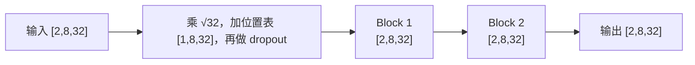
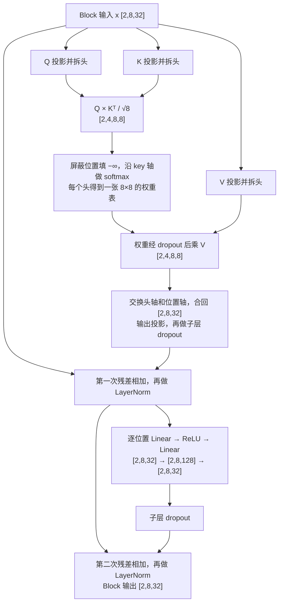

# 两层 Encoder 中的张量形状

取两条长度为 8 的序列，每个位置有 32 个特征，输入形状是 `[2,8,32]`。位置编码只在入口加一次。两个 Block 各有一套参数，接收同一份 Mask。第二层的输出就是 Encoder 的返回值。[Encoder 实现](../../../src/petvision/models/transformer/blocks.py)



## 展开一个 Block



Q、K、V 投影后各是 `[2,8,32]`。把 32 个特征分给 4 个头，先得到 `[2,8,4,8]`，再交换中间两轴。下表中的三个张量恰好都有相同的形状，沿最后一轴做的计算却不同。[Attention 实现](../../../src/petvision/models/transformer/attention.py)

| 张量 | 形状 | 最后两轴的含义 |
| --- | --- | --- |
| 拆头后的 Q | `[2,4,8,8]` | query 位置、头内特征。每个 query 用 8 个特征与各个 key 做点积 |
| 分数与权重 | `[2,4,8,8]` | query 位置、key 位置。每行 softmax 后，可读 key 的权重和为 1 |
| 权重乘 V | `[2,4,8,8]` | query 位置、头内特征。每个位置拿回一个 8 维的加权结果 |

因果表按 `[1,1,T,T]` 广播，padding 表按 `[B,1,1,T]` 广播，两表取逻辑或。以第一条序列为例，把最后一个 key 标为 padding 后，合并 Mask 下的 query 0 只读 key 0，query 7 能读 key 0 到 6。若整行都被屏蔽，当前实现会在 softmax 前抛出 `ValueError`。

第一条残差从 Block 输入绕过 Attention；第二条从第一次归一化的输出绕过 FFN。两次相加时都是两个 `[2,8,32]` 张量，随后分别沿 32 个特征归一化。这是当前 Encoder 的 post-LN 顺序。

## 复核运行

在项目根目录激活 `petvision` 后运行以下命令。两层的入口、出口形状以及代表参数的梯度会打印到终端。[堆叠与因果测试](../../../tests/test_encoder.py)

```bash
python -m pytest tests/test_encoder.py::test_encoder_stack tests/test_encoder.py::test_encoder_causal_mask -q -s
```

本次用 CPU float64、4 个头、FFN 宽度 128、dropout=0。两层各自的 Q 投影拆头后都是 `[2,4,8,8]`，FFN 中间值都是 `[2,8,128]`，两个出口都是 `[2,8,32]`。第一层 Q 投影与第二层 FFN 输出投影的梯度形状分别为 `[32,32]` 和 `[32,128]`，均为有限值。把后四个输入位置加 10 后，前四个位置在因果 Mask 下的最大变化为 0，双向 Attention 下约为 2.883892。
